<div align="center">


# Shellie

**One work item, one worktree, one set of agent terminals, a brain that knows the project, and a bill you can send.**

Shellie turns an Azure DevOps work item into an isolated workspace: its own git worktree and branch, Claude Code,
Copilot, OpenCode and shell terminals, an exact count of the AI cost and time the task took, and a second brain per
project that your agents read before they start.

[](https://github.com/UnreliableWitness/Shellie/actions/workflows/ci.yml)
[](https://github.com/UnreliableWitness/Shellie/releases/latest)


[](LICENSE)

[**Download for Windows**](https://github.com/UnreliableWitness/Shellie/releases/latest/download/Shellie-Setup.exe) ·
[**macOS (Apple Silicon)**](https://github.com/UnreliableWitness/Shellie/releases/latest/download/Shellie.dmg) ·
[Features](#features) ·
[Brain](#a-brain-per-project) ·
[Getting started](#getting-started) ·
[`.shellie.yml`](#configure-a-repo-with-shellieyml) ·
[Development](#development)

</div>

<p align="center">
  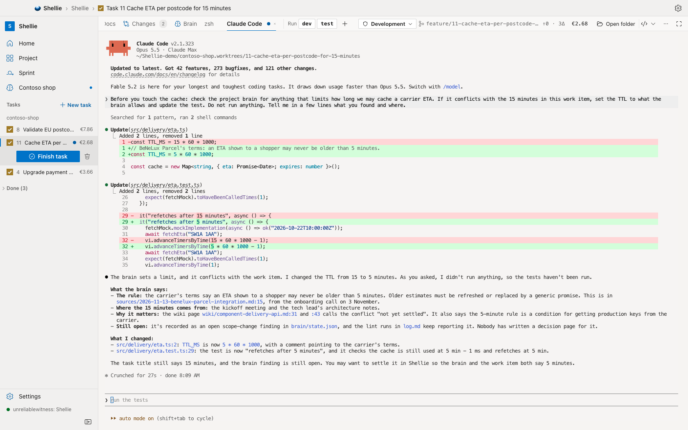
</p>

---

## Why Shellie

Working with AI agents means running several tasks at once, each in its own checkout, each with an agent burning
tokens, and each agent starting from zero about the customer and the project. Shellie gives every task its own room,
keeps the books and remembers what the project knows:

- **No more branch juggling.** Every task is a git worktree on its own branch, set up and ready before you type.
- **Agents with context.** Claude Code and OpenCode start with the whole work item (fields, description, acceptance
  criteria, comments) and read access to the project's brain.
- **Cost you can invoice.** Every AI request is a priced record in EUR, attributed to the task and its work item, on
  consumption-based licences, so it can go on the customer's bill.
- **Knowledge that stays.** Statements of work, meeting transcripts, decks and the project wiki become a wiki your
  agents read, a book you can read, and long reads that tell you what changed.
- **Azure DevOps stays current.** Work items move to In Progress, draft PRs are created with an AI-written summary and
  linked, and time can be written back.

## How it works

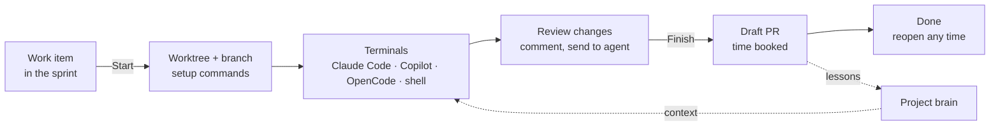

1. **Pick a work item** on Home, the Project page or the Sprint page and press **Start**. When several repos share the
   project, Shellie asks which one.
2. Shellie creates the worktree and branch, copies what the repo needs, moves the work item to In Progress and assigns
   it to you. The New task page shows exactly what it will do, with an Edit link on every line.
3. **Work** in the task's terminals. Setup commands such as `npm ci` run in their own tab, so you can start at once.
4. **Review** the changes in a diff view, leave comments on lines and send them to an agent.
5. **Finish**: Shellie pushes, opens a draft pull request linked to the work item with a summary Claude drafts, books
   the time, optionally saves what the task taught into the brain, and cleans up the worktree. It refuses to throw
   away uncommitted files or unpushed commits without asking. Finished tasks keep their summary and can be reopened.

## A look around

<table>
<tr>
<td width="50%" valign="top">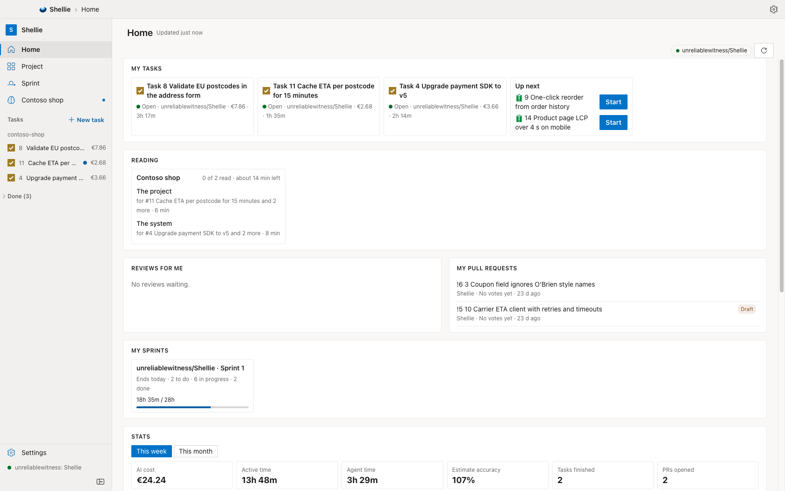<br /><b>Home</b>: your tasks, pull requests and sprints across projects, with the week's cost and time.</td>
<td width="50%" valign="top">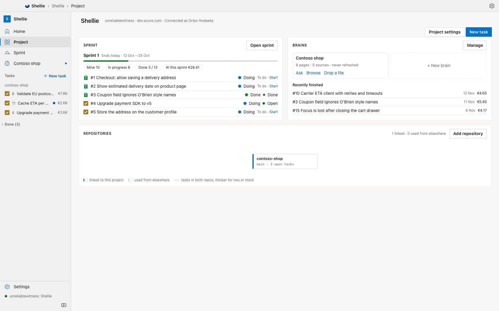<br /><b>Project</b>: the sprint, the project's brains, what was finished lately and how its repositories hang together.</td>
</tr>
<tr>
<td valign="top">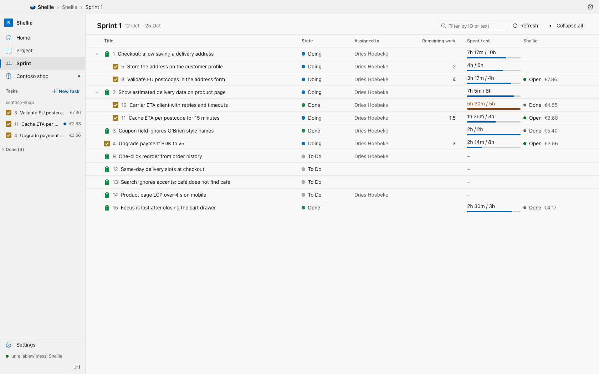<br /><b>Sprint</b>: any sprint of any of your teams in backlog order, time spent against the estimate, and Start on every row.</td>
<td valign="top">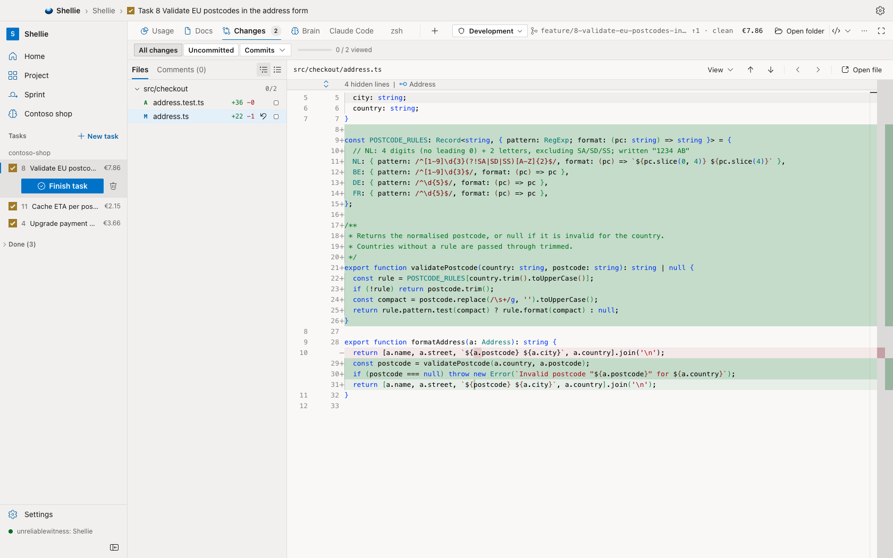<br /><b>Changes</b>: everything the task changed, in the Monaco diff editor, with line comments for the agent.</td>
</tr>
<tr>
<td valign="top">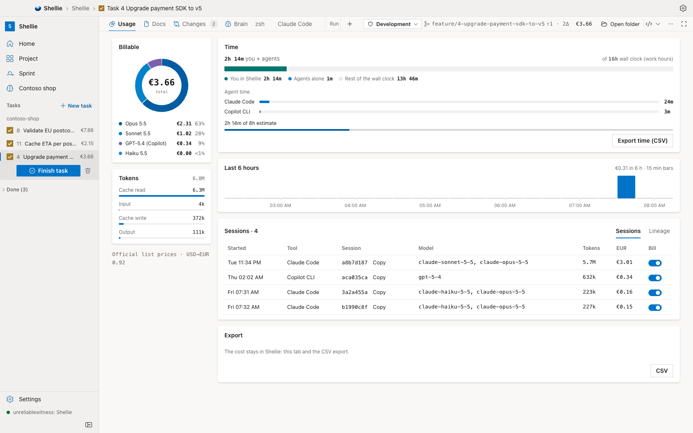<br /><b>Usage</b>: cost per model, tokens, your time against the agents', the last six hours, and every session with its subagents.</td>
<td valign="top">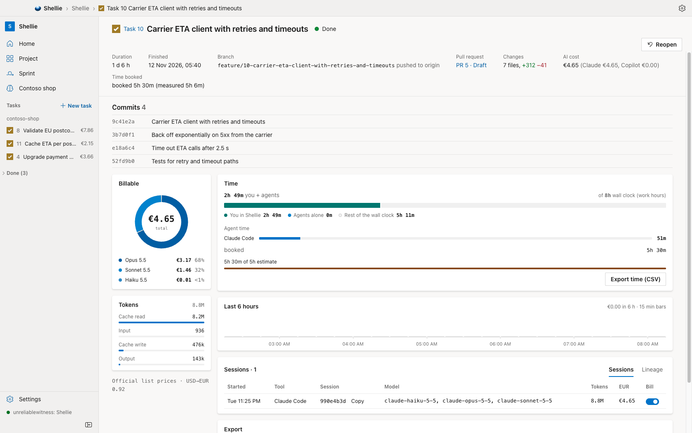<br /><b>Done</b>: what a finished task took: commits, the pull request, the AI cost and the time booked. Reopen brings it back.</td>
</tr>
</table>

<sub>Screenshots show a demo project with demo usage data.</sub>

## Features

<table>
<tr>
<td width="50%" valign="top">

### Task workspaces

- A git worktree and branch per task, named from the work item (`feature/1234-fix-login`)
- Per-repo setup from `.shellie.yml`, with `node_modules` cloned instantly on macOS when the lockfile matches
- Tasks that span several repos: detected from what the agent edits, with one PR per repo
- Tasks with **no repo**: a scratch folder with the terminals and the brain, for questions and research
- Focus mode, a tab per terminal, and terminals that come back after a restart

</td>
<td width="50%" valign="top">

### Agents in the terminal

- Claude Code, GitHub Copilot CLI, OpenCode and your shell, side by side
- `.shellie/task.md` holds the whole work item and its comments; Claude Code and OpenCode start with it
- Your own start command per repo (`claude --permission-mode acceptEdits`), sessions kept across relaunches
- Clickable `path:line` and links, **Send to** a terminal, image paste, and copy and paste like VS Code
- Agent packages installed per harness when the repo has an `apm.yml`

</td>
</tr>
<tr>
<td valign="top">

### AI cost per task

- Every request from Claude Code, OpenCode (any provider) and Copilot CLI kept as a priced record
- Priced at the official list prices, converted to EUR, the same for every teammate
- A Usage tab per task: cost per model, tokens, sessions with their subagents, the last six hours
- Monthly **Claude** and **Copilot** budgets on Home, with a daily allowance and forecast
- An optional company **cost server** for invoicing; nothing about cost goes to Azure DevOps

</td>
<td valign="top">

### Time tracking

- Your time in Shellie, plus agent time from Claude Code, Copilot and OpenCode
- Finish suggests the measured time and books the value you choose
- A Spent / estimate column on the Sprint page, rolled up to parents
- Optional write-back to Completed and Remaining Work, per project

</td>
</tr>
<tr>
<td valign="top">

### Azure DevOps

- Home: your tasks, PRs to review, your PRs and your sprints, across organizations
- A **Project** page per project: sprint, brains, recent work and a graph of its repositories
- The Sprint page in backlog order, any team's sprint, with real work item icons and state colours
- Draft pull requests with an AI-written summary, styled by the repo's `.shellie-pr.md`
- Several organizations and projects at once, each repo linked to its own

</td>
<td valign="top">

### A brain per project

- A local git wiki an agent keeps from your documents and the project's Azure DevOps wiki
- PDF, Word, PowerPoint, Excel, draw.io, XML, transcripts and pictures, with a secret scan at the door
- Read it as a book, ask it questions, and settle the contradictions it finds
- Long reads that explain the project, a reading list for your sprint, and letters when things change
- Every task's agents get read access; Finish can save what the task taught

</td>
</tr>
<tr>
<td valign="top">

### Review and docs

- **Changes**: all changes, uncommitted or per commit, in the Monaco diff editor
- Line comments that follow the code and can be sent to an agent
- **Docs**: the Markdown your agents wrote, rendered with Mermaid and code highlighting
- HTML files open in a tab of the task; open the repo in VS Code or Visual Studio

</td>
<td valign="top">

### Secrets

- Each repo's secrets kept encrypted on your machine, per environment
- Env files and the dev server get them; Claude Code, Copilot and OpenCode never do
- Agents run tests through `shellie run <name>` and see masked output
- UAT and Production ask first, show a coloured band and time out

</td>
</tr>
</table>

Shellie follows the system's light or dark theme by default, and so do its terminals and Claude Code; Settings ›
Appearance can pin it to Light or Dark.

## A brain per project

A brain is a local git folder per Azure DevOps project, kept by an agent as a wiki: raw sources in `sources/`, the
pages it writes in `wiki/`, and an index Shellie rebuilds from the pages. It never writes to Azure DevOps.

<p align="center">
  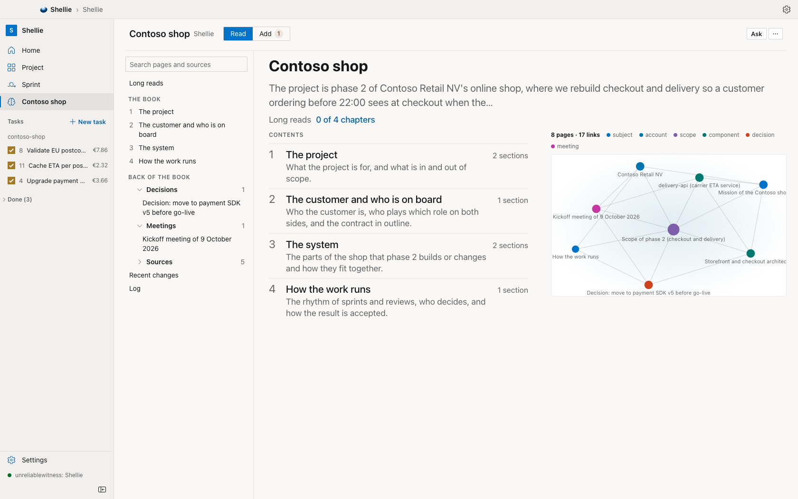
</p>

- **Feed it.** Drop files on **Brain › Add**, or write in its Markdown editor: PDF (text, pictures and drawn pages),
  Word, PowerPoint (slides, notes, SmartArt, charts), Excel, draw.io diagrams, XML, VTT transcripts, Markdown and
  text. Add a note for the agent and pick the model for this add. The project's Azure DevOps wiki is mirrored once a
  day. A file that looks like it holds a key, token or password is refused at the door.
- **Let it work.** Each add is captured into pages, then linted for contradictions. Pick Claude Code (Haiku, Sonnet or
  Opus) or OpenCode per brain; a daily token cap pauses the queue. **Activity** shows what ran, what waits for you and
  what changed. **Health** lists broken links, stale pages, uncaptured sources and pictures the agent did not get to.
- **Read it.** The brain arranges itself into a book with chapters, with a graph of how pages link, search
  (⌘K / Ctrl+K), dots on what changed since your last visit, and **Mark verified** on pages you checked.
- **Ask it.** The Ask box answers from the pages, lists its sources and says when it rests on unverified pages.
- **Settle what disagrees.** When two sources contradict each other, **Settle** shows both claims side by side.
  You pick one, both or neither, or park it with a question to send someone, and the decision becomes a page.

<table>
<tr>
<td width="50%" valign="top">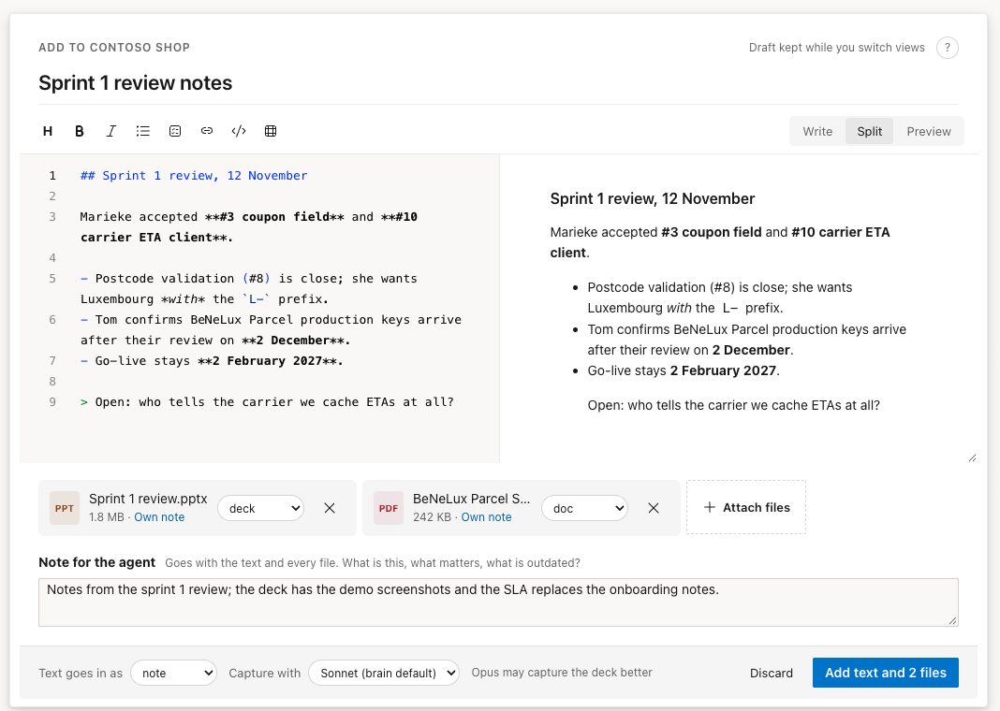<br /><b>Add</b>: Markdown with a live preview, files with their type, a note for the agent and the model to capture with.</td>
<td width="50%" valign="top">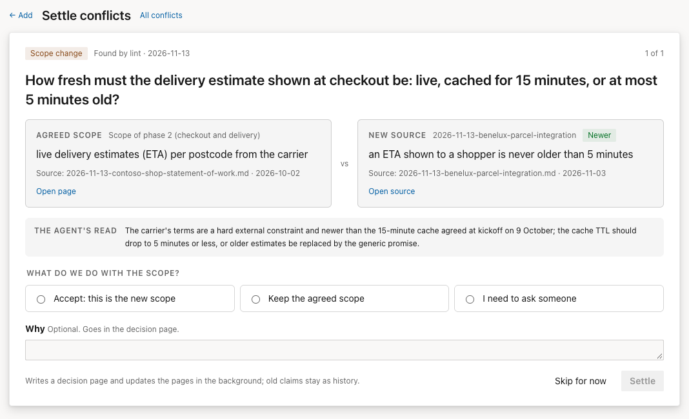<br /><b>Settle</b>: one contradiction at a time, both claims, the agent's read, and your decision.</td>
</tr>
</table>

### Long reads, the reading list and your phone

The brain also writes **long reads**: essays of one book chapter or a topic you ask for, with linked claims, a
question before you read on, and what the writer was missing. When the pages beneath an essay change, it is marked out
of date; updating it writes a **letter**: what you read, what holds now and why it changed.

<p align="center">
  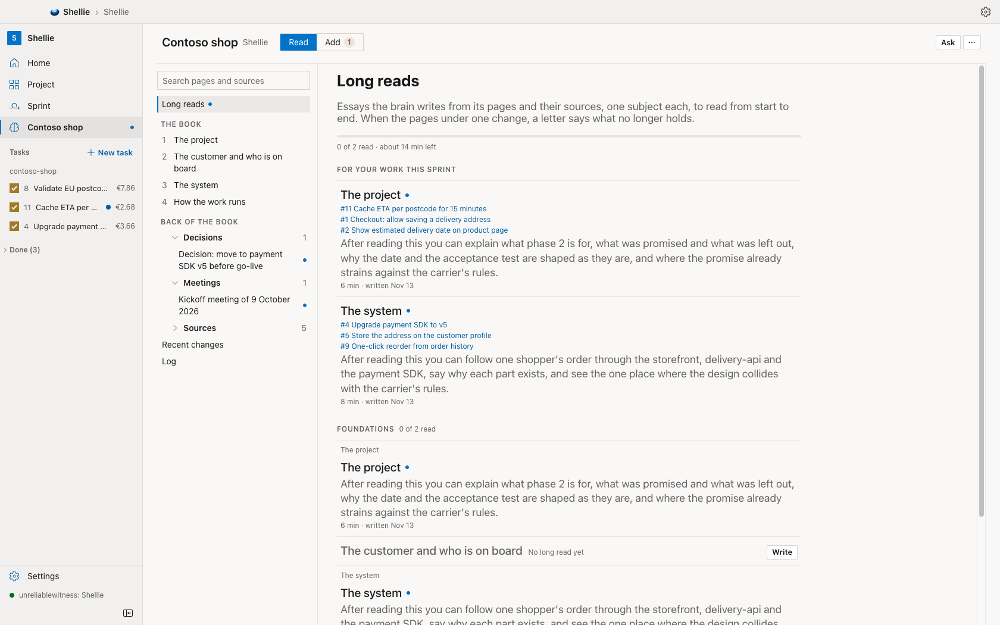
</p>

- **Brain › Read › Long reads** is a reading list: what matters for your work this sprint (matched to your work items),
  what changed since you read it, the foundations in book order, and the letters.
- Home's **Reading** band, a dot on the brain and **Before you start** on a task point at what to read, only when
  something happened. **Settings › User › Appearance › Reading nudges** turns them off.
- **Shellie Reader** puts long reads and letters on your phone, encrypted end to end, readable offline, with read marks
  synced both ways. It is a small self-hosted server and site in `reader/`: connect in **Settings › Phone** and scan the
  QR code; each brain chooses whether to send.

### Brains and tasks

A task in a project with a brain gets a **Brain context** setup step: `task.md` gets the start of the brain's index,
Claude Code gets read access with `--add-dir`, and OpenCode the same through its config, with edits denied. The task's
**Brain** tab has Ask, search, the pages that match the task and a drop zone. At Finish you can capture `task.md` into
the brain and save what the task taught as lesson pages, from the task's own agent sessions.

## Getting started

### Install

| Platform | How |
| --- | --- |
| **Windows** | Download [`Shellie-Setup.exe`](https://github.com/UnreliableWitness/Shellie/releases/latest/download/Shellie-Setup.exe) from the [latest release](https://github.com/UnreliableWitness/Shellie/releases/latest). Shellie updates itself after that. |
| **macOS** (Apple Silicon) | Open [`Shellie.dmg`](https://github.com/UnreliableWitness/Shellie/releases/latest/download/Shellie.dmg) and drag Shellie to Applications. The build is signed and notarized, and updates itself from Applications ([docs/macos-release.md](docs/macos-release.md)). |

> [!NOTE]
> The Windows installer is not signed yet, so SmartScreen may warn about it. Choose **More info → Run anyway**.

After an update, Home shows **What's new**: the changes in each release since you last looked.

### First run

On a fresh install Shellie opens a **Get started** page with four steps: check which agents (Claude Code, Copilot CLI,
OpenCode) are on this machine and pick the terminals new tasks open; connect Azure DevOps (organization, token,
projects); add your first repository; and, optionally, create a brain for the project on Claude Code or OpenCode.
Every step can be skipped and finished later from Settings. **Skip for now** hides the page, and Settings › About ›
Get started opens it again. Until you skip, a Get started band on Home lists the steps you haven't finished.

### Connect Azure DevOps

1. Create a personal access token with **Work Items (Read & write)**, **Code (Read & write)**, **Project and
   Team (Read)** and, for a brain, **Wiki (Read)**.
2. In Shellie, open **Settings › User › Projects** and choose **Add project…** with your organization URL and the
   token. Tokens are encrypted with the operating system's secure storage and never leave your machine except to Azure
   DevOps. Every project you tick gets its own Project page.
3. Add a repo in **Settings › Repository** with **Add folder…** and pick its project.
4. Open the Sprint page and press **Start** on a work item.

### Settings

<p align="center">
  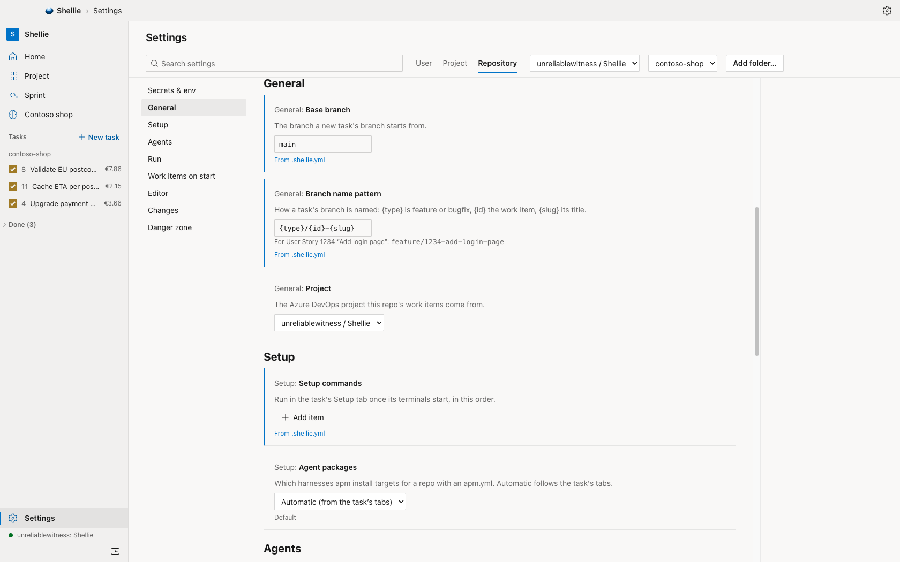
</p>

Settings is one searchable page (⌘F / Ctrl+F) with three scopes. **User** holds what is yours: projects, agents and
terminals, budgets, the cost server, your phone and appearance. **Project** holds a project's connection, what happens
to work items on start, time write-back and its brains. **Repository** holds everything about one repo, from secrets
and env files to setup, agents, run commands and the Changes view. A blue bar marks a value that differs from its
default, and every row says where its value comes from.

## Configure a repo with `.shellie.yml`

Every key is optional. Without the file, Shellie branches from the repo's default branch and runs `npm ci` when the
repo has a `package-lock.json`. Values you change in **Settings › Repository** are kept on your machine and win over
the file; **Create .shellie.yml** writes one for you. Unknown keys make the file invalid, and Settings says so.

```yaml
# .shellie.yml, at the root of the repo
base: develop                     # branch new tasks start from
branch: "{type}/{id}-{slug}"      # {type}: feature or bugfix, {id}: the work item, {slug}: its title

copy:                             # untracked files copied from the main checkout
  - .env.local
  - appsettings.Development.json

copyAgentConfig: true             # default: also copy untracked opencode.json(c), .opencode/, .mcp.json,
                                  # .claude/settings.local.json and .vscode/mcp.json; false turns it off

setup:                            # runs in a Setup tab once the terminals are open
  - npm ci
  - npm run build:deps

run:                              # named commands: a Run button each, and `shellie run <name>` for agents
  dev: npm run dev
  test: npm test

apm: [claude, copilot]            # agent packages per harness, or false to skip; default follows the task's tabs
review:
  collapse: ["**/*.snap", "package-lock.json"]   # folded in the Changes view
```

Two more files at the repo root are read when present: `apm.yml` (its `targets:` limit which harnesses get agent
packages) and `.shellie-pr.md` (a style guide for the pull request summary).

## How cost is counted

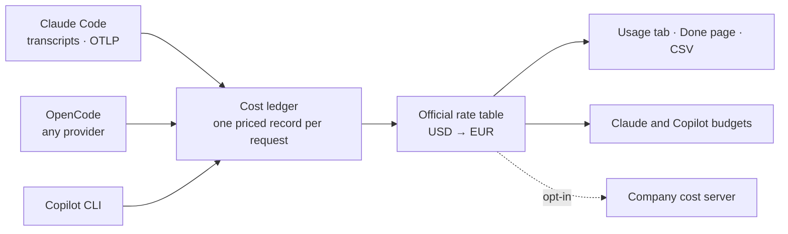

- Each agent terminal is started with `OTEL_RESOURCE_ATTRIBUTES=shellie.task.id=<id>`, and the ledger reads Claude
  Code's transcripts, OpenCode's database and Copilot CLI's traces, so every request lands on the right task and work
  item. Requests outside a task are kept too, attributed to their repo or to nobody.
- Prices come from a built-in table of official list prices and a fixed USD to EUR rate, so every teammate gets
  identical numbers. A task can be marked not billable; a brain's own usage never is billable.
- **Settings › User › Cost server** (off by default) sends the records to your company's cost server in the
  background, for invoicing. Prompts, responses, code, paths and terminal output are never sent; the work item title
  and type are. Budgets set on the server show up in Shellie.

<p align="center">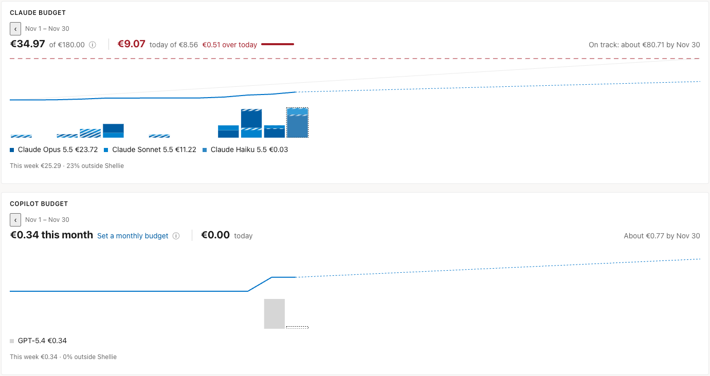</p>

The **Claude budget** on Home counts every Claude Code session on the machine, in Shellie or outside it (hatched),
against a monthly budget, with what is left for today and a forecast for the month. A **Copilot budget** does the
same for Copilot.

## Secrets

**Settings › User › Secrets** and **Settings › Repository › Secrets & env** keep each repo's secrets encrypted on your
machine (Electron `safeStorage`), one value per environment: Development, Test, UAT and Production. Shellie finds
what the repo already has (`.env*` files, `appsettings.<Environment>.json`, launch profiles, .NET user secrets,
`.vscode/launch.json`, docker-compose, `local.settings.json`, `secrets/` folders) and imports what you tick; worktrees
then get their env files without those values. The values go only into the tabs you give them to (Setup, the dev
server, tests, and your own shell if you choose), never into Claude Code, Copilot or OpenCode tabs. Agents run tests
and the dev server through `shellie run <name>`, which runs the repo's named command with the secrets in a Shellie tab
and hands back masked output. A task picks its environment when it starts and can switch from the task bar; UAT and
Production ask first and show a coloured band, and Production goes back to Development after 60 minutes and at
Finish. Claude Code and OpenCode are denied reading the untracked secret files (Copilot has no such setting), and a
stored value showing up in agent output, in Changes or in the branch Finish pushes is masked and flagged, and pauses
the tab for Production. This guards against accidents, not against an agent set on leaking: an agent can change what
a named command runs, which is why UAT and Production runs show the resolved script before you approve them. Nothing
changes for a repo until you import something.

## Privacy

Shellie sends anonymous usage events and errors to Azure Application Insights to find bugs. Paths and repo, task, work
item and organization names are scrubbed first, and local builds send nothing. Turn it off in **Settings ›
Appearance** or with `SHELLIE_TELEMETRY=0`. Everything collected is listed in [docs/telemetry.md](docs/telemetry.md).
Crash dumps stay on your machine, under `Crashpad` in Shellie's data folder; they can hold secrets, so look before you
share one.

## Development

```bash
git clone https://github.com/UnreliableWitness/Shellie.git
cd Shellie
npm install        # also fixes node-pty's spawn-helper permissions
npm start          # run the app
SHELLIE_USER_DATA=/tmp/shellie-fresh npm start   # run on a separate, fresh data folder
```

| Command | What it does |
| --- | --- |
| `npm test` | Vitest unit tests |
| `npm run typecheck` | TypeScript, no emit |
| `npm run lint` | oxlint and oxfmt |
| `npm run icons` | Render the app icons from `assets/icon/*.svg` |
| `npm run reader:build` | Build the phone reader's server and site in `reader/` |

**Built with** Electron, React, TypeScript, xterm.js, node-pty, Monaco and Vite (Electron Forge). Platform-specific
shell, path and process logic sits behind a `Platform` interface, so Windows and macOS are module swaps.

**Releases**: twice a day, at 12:00 and 17:00 Brussels time, the app changes merged to `main` since the last release
become the next minor version, built for Windows and macOS (Apple Silicon) and published as a GitHub Release that
installed copies pick up through auto-update. **Release now** (Actions › CI › Run workflow on `main`) or a `vX.Y.Z` tag
releases at once; merges that only touch docs, tests or tooling make no version. See
[docs/windows-checklist.md](docs/windows-checklist.md) for checking a Windows build by hand.

**Agents on GitHub**: issues are triaged, implemented, reviewed, fixed and merged by agents on GitHub Actions; see
[docs/agents.md](docs/agents.md). What changed and why lives in [docs/changes](docs/changes), one note per change;
designs and plans live in [docs/superpowers/specs](docs/superpowers/specs) and
[docs/superpowers/plans](docs/superpowers/plans).

## License

[MIT](LICENSE)
