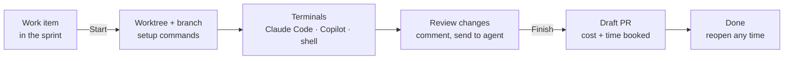
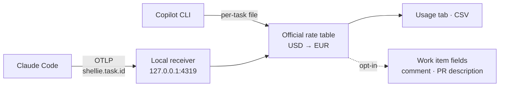

<div align="center">


# Shellie

**One work item, one worktree, one set of agent terminals, and a bill you can send.**

Shellie turns an Azure DevOps work item into an isolated workspace: its own git worktree and branch, Claude Code,
Copilot and shell terminals, and an exact count of the AI cost and time the task took.

[](https://github.com/UnreliableWitness/Shellie/actions/workflows/ci.yml)
[](https://github.com/UnreliableWitness/Shellie/releases/latest)


[](LICENSE)

[**Download for Windows**](https://github.com/UnreliableWitness/Shellie/releases/latest) ·
[macOS](docs/macos-release.md) ·
[Features](#features) ·
[Getting started](#getting-started) ·
[`.shellie.yml`](#configure-a-repo-with-shellieyml) ·
[Development](#development)

</div>

<p align="center">
  
</p>

---

## Why Shellie

Working with AI agents means running several tasks at once, each in its own checkout, each with an agent burning
tokens. Shellie gives every task its own room and keeps the books:

- **No more branch juggling.** Every task is a git worktree on its own branch, set up and ready before you type.
- **Agents with context.** Claude Code starts knowing the work item it is working on.
- **Cost you can invoice.** Token usage is captured per task and priced at the official list prices in EUR, on
  consumption-based licences, so it can go on the customer's bill.
- **Azure DevOps stays current.** Work items move to In Progress, draft PRs are created and linked, and time and cost
  can be written back.

## How it works



1. **Pick a work item** on Home or the Sprint page and press **Start**.
2. Shellie creates the worktree and branch, copies what the repo needs, moves the work item to In Progress and assigns
   it to you.
3. **Work** in the task's terminals. Setup commands such as `npm ci` run in their own tab, so you can start at once.
4. **Review** the changes in a diff view, leave comments on lines and send them to an agent.
5. **Finish**: Shellie pushes, opens a draft pull request linked to the work item, books the time and cleans up the
   worktree. Finished tasks keep their summary and can be reopened.

## A look around

<table>
<tr>
<td width="50%" valign="top"><br /><b>Home</b>: your tasks, pull requests and sprints across organizations, with the week's cost and time.</td>
<td width="50%" valign="top"><br /><b>Sprint</b>: the current sprint in backlog order, time spent against the estimate, and Start on every row.</td>
</tr>
<tr>
<td valign="top"><br /><b>Changes</b>: everything the task changed, in the Monaco diff editor, with line comments for the agent.</td>
<td valign="top"><br /><b>Usage</b>: cost per model, tokens, your time against the agents', and the last six hours.</td>
</tr>
<tr>
<td colspan="2" valign="top"><br /><b>Done</b>: what a finished task took: commits, the pull request, the AI cost and the time booked. Reopen brings it back.</td>
</tr>
</table>

<sub>Screenshots show a demo project with demo usage data.</sub>

## Features

<table>
<tr>
<td width="50%" valign="top">

### Task workspaces

- A git worktree and branch per task, named from the work item (`feature/1234-fix-login`)
- Per-repo setup from `.shellie.yml`, with `node_modules` cloned instantly on macOS when the lockfile matches
- Tasks that span several repos: detected from what the agent edits, with one PR per repo
- Focus mode, a tab per terminal, and terminals that come back after a restart

</td>
<td width="50%" valign="top">

### Agents in the terminal

- Claude Code, GitHub Copilot CLI, OpenCode and your shell, side by side
- Claude Code gets the work item as context and keeps its session across relaunches
- Clickable `path:line` and links, **Send to** a terminal, and copy and paste like VS Code
- Agent packages installed per harness when the repo has an `apm.yml` (only for the harnesses its `targets:` lists, when it has one)

</td>
</tr>
<tr>
<td valign="top">

### AI cost per task

- Claude Code usage captured through OpenTelemetry, tagged with the task
- Priced at the official list prices, converted to EUR, the same for every teammate
- A Usage tab per task: cost per model, tokens, the last six hours
- Optional write-back to `Custom.AI*` fields and a comment on the work item
- A monthly **Claude budget** on Home with a daily allowance and forecast

</td>
<td valign="top">

### Time tracking

- Your time in Shellie, plus agent time from Claude Code, Copilot and OpenCode
- Finish suggests the measured time and books the value you choose
- A Spent / estimate column on the Sprint page, rolled up to parents
- Optional write-back to Completed and Remaining Work

</td>
</tr>
<tr>
<td valign="top">

### Azure DevOps

- Home: your tasks, PRs to review, your PRs and your sprints, across organizations
- The Sprint page in backlog order, with real work item icons and state colours
- Draft pull requests with the commits and cost in the description
- Several organizations at once, each repo linked to its own connection

</td>
<td valign="top">

### Review and docs

- **Changes**: all changes, uncommitted or per commit, in the Monaco diff editor
- Line comments that follow the code and can be sent to an agent
- **Docs**: the Markdown your agents wrote, rendered with Mermaid and code highlighting
- HTML files open in a tab of the task; open the repo in VS Code or Visual Studio

</td>
</tr>
</table>

Shellie follows the system's light or dark theme, and so do its terminals and Claude Code.

## Getting started

### First run

On a fresh install Shellie opens a **Get started** page with three steps: check which agents (Claude Code, Copilot CLI,
OpenCode) are on this machine and pick the terminals new tasks open, connect Azure DevOps (organization, token,
projects), and add your first repository. Every step can be skipped and finished later from Settings; **Skip for now** hides the page; the unfinished steps stay in Settings, and Settings › About › Get started opens the page again. Until you skip, a Get started band on Home lists the steps you haven't finished.

### Install

| Platform | How |
| --- | --- |
| **Windows** | Download `Shellie-Setup.exe` from the [latest release](https://github.com/UnreliableWitness/Shellie/releases/latest). Shellie updates itself after that. |
| **macOS** (Apple Silicon) | Open `Shellie.dmg` from the [latest release](https://github.com/UnreliableWitness/Shellie/releases/latest) and drag Shellie to Applications; it updates itself from there. Until the signing secrets are set up ([docs/macos-release.md](docs/macos-release.md)) releases carry no Mac build: build from source (see [Development](#development)). |

> [!NOTE]
> Until the first signed build ships, Windows SmartScreen may warn about the installer. Choose **More info → Run
> anyway**.

### Connect Azure DevOps

1. Create a personal access token with **Work Items (Read & write)**, **Code (Read & write)** and **Project and
   Team (Read)**.
2. In Shellie, open **Settings → Connections** and add a connection with your organization URL and the token. Tokens
   are encrypted with the operating system's secure storage and never leave your machine except to Azure DevOps.
3. Add a repo under **Settings → Repositories** and link it to the connection.
4. Open the Sprint page and press **Start** on a work item.

## Configure a repo with `.shellie.yml`

Every key is optional. Without the file, Shellie branches from `main` and runs `npm ci` when the repo has a
`package-lock.json`.

```yaml
# .shellie.yml, at the root of the repo
base: develop                     # branch new tasks start from
branch: "{type}/{id}-{slug}"      # {type} from the work item type, {id}, {slug} from the title

copy:                             # untracked files copied from the main checkout
  - .env.local
  - appsettings.Development.json

copyAgentConfig: true             # default: also copy untracked opencode.json(c), .opencode/, .mcp.json,
                                  # .claude/settings.local.json and .vscode/mcp.json; false turns it off

setup:                            # runs in a Setup tab once the terminals are open
  - npm ci
  - npm run build:deps

run:                              # named commands: a Run button each in the task's tab row
  dev: npm run dev
  storybook: npm run storybook

apm: [claude, copilot]            # agent packages per harness, or false to skip
review:
  collapse: ["**/*.snap", "package-lock.json"]   # folded in the Changes view
```

## How cost is counted



- Each agent terminal is started with `OTEL_RESOURCE_ATTRIBUTES=shellie.task.id=<id>`, so every token lands on the
  right task.
- Prices come from a built-in table of official list prices and a fixed USD to EUR rate, so every teammate writes
  identical numbers.
- Writing cost to Azure DevOps is off by default (**Settings → AI cost and invoicing**). Managers invoice from Azure
  DevOps queries on the `Custom.AI*` fields.

<p align="center"></p>

The **Claude budget** on Home counts every Claude Code session on the machine, in Shellie or outside it (hatched), against a
monthly budget, with what is left for today and a forecast for the month.

## Secrets

**Settings → Secrets** keeps each repo's secrets encrypted on your machine (Electron `safeStorage`), one value per
environment: Development, Test, UAT and Production. Shellie finds what the repo already has (`.env*` files,
`appsettings.<Environment>.json`, launch profiles, .NET user secrets, `.vscode/launch.json`, docker-compose,
`local.settings.json`, `secrets/` folders) and imports what you tick; worktrees then get their env files without those
values. The values go only into the tabs you give them to (Setup, the dev server, tests, and your own shell if you
choose), never into Claude Code, Copilot or OpenCode tabs. Agents run tests and the dev server through
`shellie run <name>`, which runs the repo's named command with the secrets in a Shellie tab and hands back masked
output. A task picks its environment when it starts and can switch from the task bar; UAT and Production ask first and
show a coloured band, and Production goes back to Development after 60 minutes and at Finish. Claude Code and OpenCode
are denied reading the untracked secret files (Copilot has no such setting), and a stored value showing up in agent
output, in Changes or in the branch Finish pushes is masked and flagged, and pauses the tab for Production. This
guards against accidents, not against an agent set on leaking: an agent can change what a named command runs, which
is why UAT and Production runs show the resolved script before you approve them. Nothing changes for a repo until you
import something.

## Privacy

Shellie sends anonymous usage events and errors to Azure Application Insights to find bugs. Paths and repo, task, work
item and organization names are scrubbed first, and local builds send nothing. Turn it off in **Settings → Appearance**
or with `SHELLIE_TELEMETRY=0`. Everything collected is listed in [docs/telemetry.md](docs/telemetry.md).

## Development

```bash
git clone https://github.com/UnreliableWitness/Shellie.git
cd Shellie
npm install        # also fixes node-pty's spawn-helper permissions
npm start          # run the app
```

| Command | What it does |
| --- | --- |
| `npm test` | Vitest unit tests |
| `npm run typecheck` | TypeScript, no emit |
| `npm run lint` | oxlint and oxfmt |
| `npm run icons` | Render the app icons from `assets/icon/*.svg` |

**Built with** Electron, React, TypeScript, xterm.js, node-pty, Monaco and Vite (Electron Forge). Platform-specific
shell, path and process logic sits behind a `Platform` interface, so Windows and macOS are module swaps.

**Releases**: every merge to `main` builds `Shellie-Setup.exe` on CI and publishes the next minor version as a GitHub
Release, which installed copies pick up through auto-update. See [docs/windows-checklist.md](docs/windows-checklist.md)
for checking a Windows build by hand.

Designs and plans for each feature live in [docs/superpowers/specs](docs/superpowers/specs) and
[docs/superpowers/plans](docs/superpowers/plans).

## License

[MIT](LICENSE)
