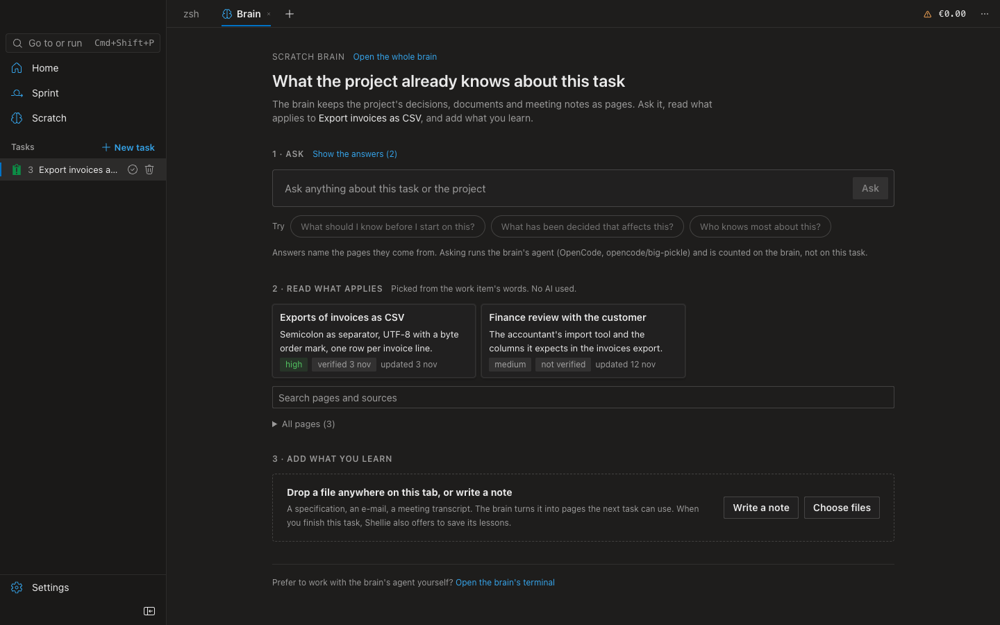
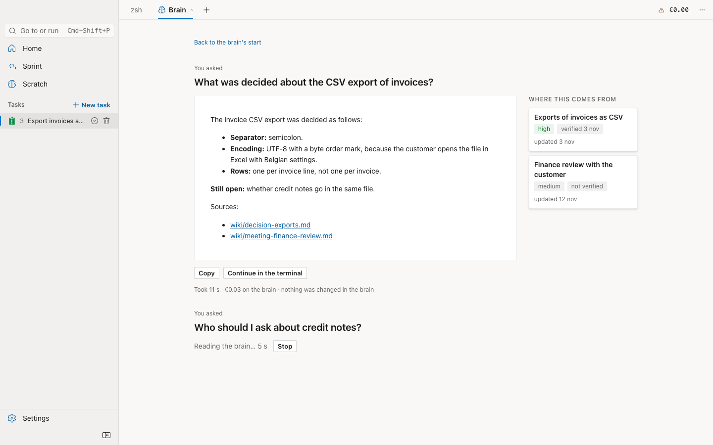

# A guided Brain tab in a task

Date: 2026-11-26, branch `feat/guided-brain-tab`. Asked by the owner in a session: the "<name> brain" tab in a task
was a bare agent terminal, "its an empty terminal its confusing. Can we have a bespoke view that guides a user?"
Spec `docs/superpowers/specs/2026-11-26-guided-brain-tab-design.md`, plan
`docs/superpowers/plans/2026-11-26-guided-brain-tab.md`, mockups on the design canvas the spec links (the owner
picked direction A, and "open from the start" for the tab).

## What changed

- **The Brain tab is a guide.** A head says what a brain is and names the task's work item, then three steps:
  1. **Ask**: a question field that is always there, three suggested questions, and a line on what asking costs.
  2. **Read what applies**: the long reads for the work item and the pages that mention the task, the search, and
     every page behind "All pages (n)".
  3. **Add what you learn**: drop a file anywhere on the tab, "Choose files", or "Write a note" (the brain's Add
     view).

  A foot link opens the brain's terminal.
- **Answers show in the tab.** A question runs the brain's agent in the background; the answer is rendered with
  the pages and sources it names as links and as cards ("Where this comes from"), how long it took, and the cost
  once the ledger has it. Follow-ups continue the same session and stack under each other. "Copy", "Continue in
  the terminal" and, when the task has an agent tab, "Send to this task's agent".
- **The Brain tab is in a task's tab row from the start**, not selected, for a ready task with a brain. Closed, it
  stays closed for the session until "Show brain" brings it back. It is the only view tab that is there unasked.
- **The brain terminal never opens by itself.** The brain option "Open the brain terminal when a task starts" left
  Settings; its stored key (`openBrainTerminalOnStart`) still parses and is ignored. The terminal's tab is now
  labelled "<name> brain terminal".

## How it works

- `src/main/brain/ask.ts`, `BrainAsks`: a headless run of the brain's agent in the brain's folder with the
  terminal's own prompt (`askPrompt`), outside the job queue and without the brain's lock, one per task, 3 minutes
  at most, stoppable. It is refused at the brain's daily token cap and while the brain's jobs are held (skills too
  old for its agent, or newer than this Shellie), with the reason. Usage lands on the brain (`brainJobEnv`).
- **Read-only is enforced, not asked for.**
  - Claude Code gets `--tools Read,Glob,Grep`: it has no other tool.
  - OpenCode gets an inline config that denies every edit and every command. OpenCode merges that with the brain's
    own `opencode.json`, where a rule for a narrower pattern wins over `*`, so every pattern Shellie's brain rules
    name and every pattern found in the brain's file is denied by name (`askOpencodePermission`,
    `opencodeRulePatterns`).
- `brain:ask` adds one sentence naming the task's work item to the question (`askWithContext`), so "this" in a
  suggestion means something. `brain:askStop` stops the task's run.
- The thread lives in the renderer's store (`brainAsksByTask`, `askBrain`), so an answer lands while another tab
  or task shows. It is kept for the session and dropped with its task.
- `src/shared/brainAsk.ts`: `citedPaths` finds the `wiki/…` and `sources/…` paths an answer names, `linkCited`
  makes the ones that exist links. A path that leaves the brain is never a link or a card. The ask skill did not
  change: no numbered markers, no new skills version.
- **Send to the agent** (`src/main/brain/sendAnswer.ts`, `brain:sendAnswer`): the question and answer go to
  `.shellie/brain-answer-<n>.md` in the agent tab's own folder, and one line naming the file is typed into the
  tab's prompt without Enter. Only into a running, unpaused agent tab that waits at an empty prompt
  (`pickSendTab` in `src/main/prDraft/pickTab.ts`: the pull request draft's rule without its one-hour limit); else
  the tab says why and nothing is written. The pull request draft and this share how the task's agent tabs are
  read (`agentTabs` in `handlers.ts`).
- The amount in an answer's foot is what the brain's requests cost since the question started
  (`brainCostSince`): cost records carry no session id.

## Verified

- Unit tests for the helpers, the runner, the handlers, the store, the answer view, the tab and the tab row; the
  full suite passed (6100 tests) before the OpenCode fix below, and again after it.
- **The real app** on scratch data, both themes: the tab in the row from the start with the terminal still
  selected, the start, an answer with its cards, a page opened from an answer and Back, Back to the start and
  "Show the answers".
- **Real questions through the app**, with a question that also told the agent to create a file and run a command:
  - Claude Code (Sonnet), a first question and a follow-up on the same session: answered from the pages, cited
    them, wrote nothing, `git status` in the brain clean.
  - OpenCode (`opencode/big-pickle`): answered, cited the pages, wrote nothing.
- **OpenCode could not have written.** Asked outside the ask command to write, edit and run `git status`,
  `git log`, `ls` and `mkdir` with the app's exact ask config: every one was refused. This check found a real gap
  first: with only `*` denied, `git status` still ran (the brain's own rule won), and switching the tools off in
  the config changed nothing. The config now denies each pattern by name.

## Known gaps

- Windows: unit tests only.
- "Send to this task's agent" was not run in the real app (the scratch task had no agent tab); its rules and the
  typed line are covered by tests.
- "Continue in the terminal" and Stop were not clicked in the real app.
- OpenCode's web search and subagent tools stay available to a question.
- The brain's agent changed between two questions of one thread: the follow-up asks the new agent to resume the
  other agent's session, which fails with a message; "Try again" then starts fresh only after the thread is gone
  (a restart).
- The cost in an answer's foot is usually missing right after the answer (the ledger gets its records a little
  later) and can include a job that ran at the same moment.
- Answers are lost on restart. Long reads still open on the Brain screen, not in the tab.
- Claude Code's first run in a scratch brain under `/private/tmp` reported that reading `index.md` by path failed
  and used search instead; not seen in the app's own run.
